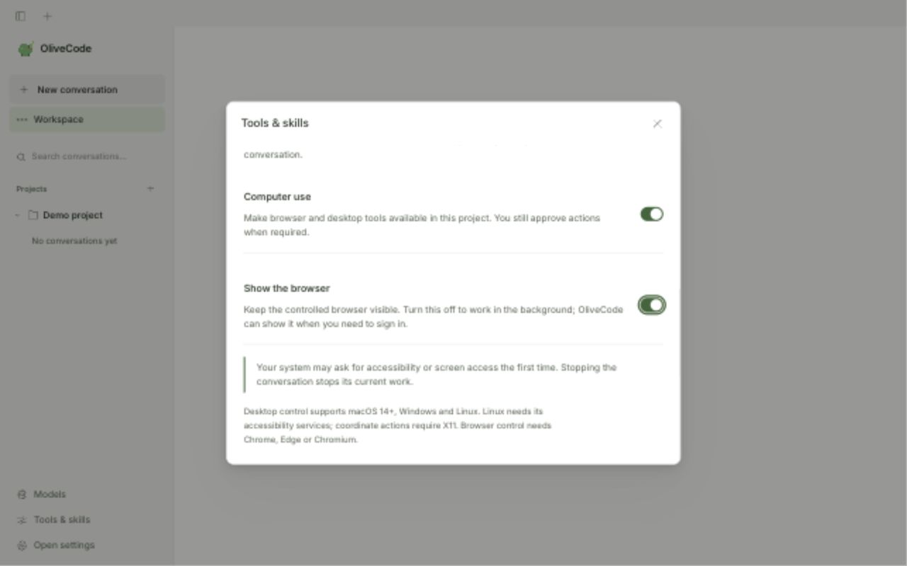

# Desktop preview verification — 2026-11-13

The screenshot is the actual running app renderer, using a disposable project,
not a design mockup. The app was checked at narrow and laptop widths and in light
and dark appearances. A packaged Mac build also opened successfully with isolated
settings; optional usage measurement was confirmed off.

Keyboard verification: Space changed “Show the browser”, the saved value updated,
and focus remained on that switch. Shared settings styles no longer change the
switch shape depending on which dialog was opened first. On narrow windows,
sidebars stay below modal dialogs.

The native phone-status test exposed the old Apple Events launcher failing on
macOS. The implementation now opens a private, self-cleaning command file through
LaunchServices, with bounded launch timeout. That replacement is built and its
argument quoting is tested, but a second native UI run was not completed after
the Mac locked. No phone account was paired or secret entered during QA.

See [the parity and release gates](../desktop-feature-parity.md) for the implemented
features, automated checks and remaining differences.
